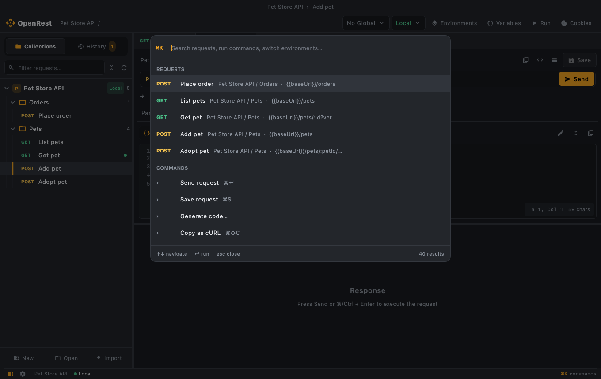
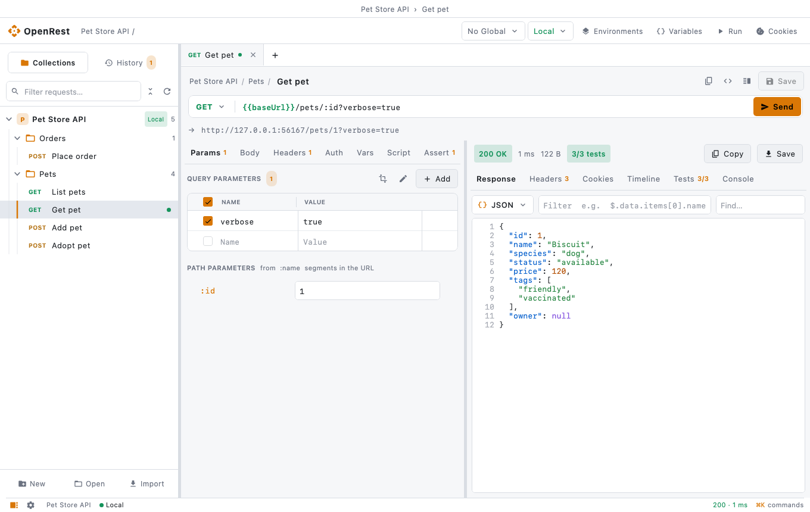
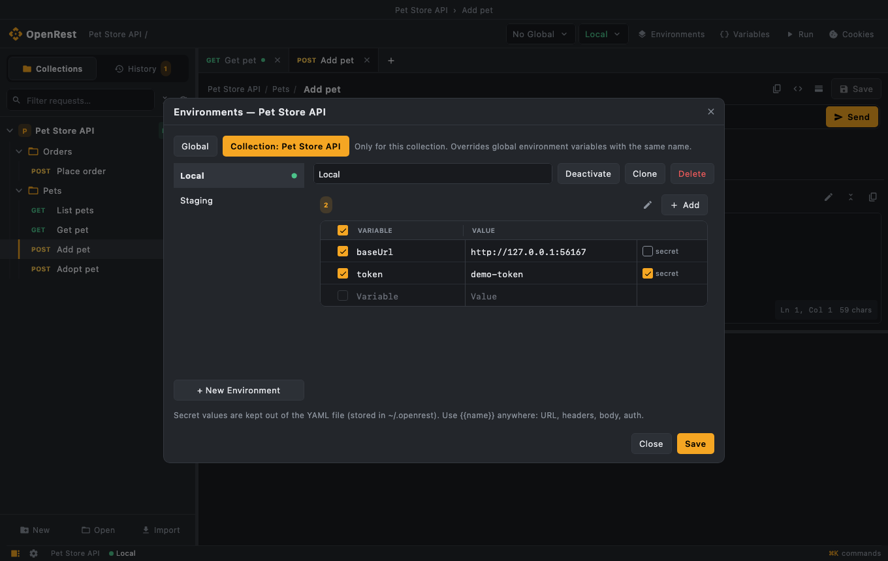
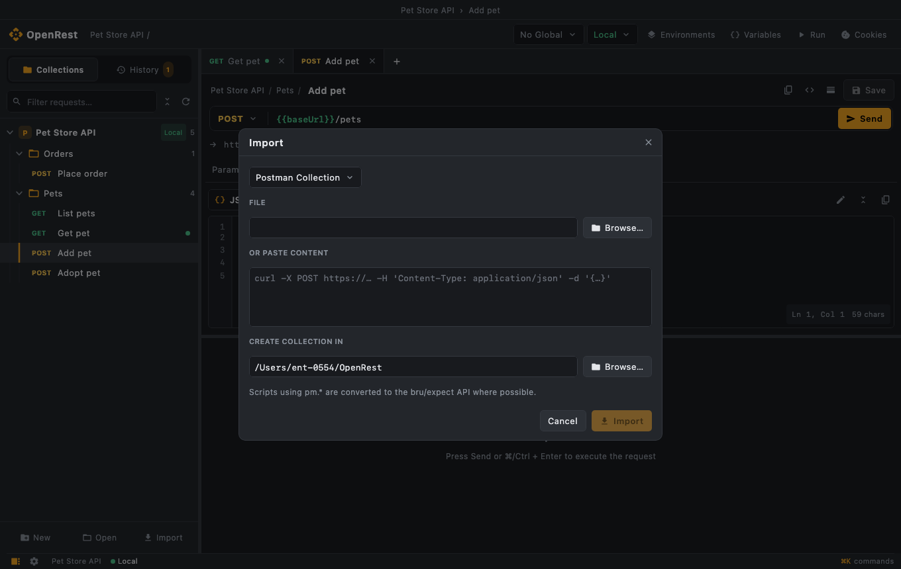

<h1 align="center">OpenRest</h1>

<p align="center">
  An open, file-based API client for the desktop. Requests, environments and workflows live in plain folders you own.<br>
  Runs on macOS, Windows and Linux.
</p>

<p align="center">
  
</p>

## Why OpenRest

- **Your data stays yours.** Collections are folders of YAML files. They diff cleanly, review well in pull requests and live in git next to your code. Nothing is sent anywhere except the requests you run.
- **More than HTTP.** REST, **GraphQL** (with a schema browser) and **WebSocket** requests, side by side in one collection.
- **Workflows, not just requests.** Chain requests together with loops, conditions and values passed from one step to the next, built visually.
- **Bring your work with you.** Import from Postman, Insomnia, Bruno, OpenAPI and cURL, and export back out to the same formats.
- **Fast and keyboard friendly.** A command palette, variable autocomplete in every field and shortcuts for everything you do often.

## Features at a glance

| | |
|---|---|
| **HTTP requests** | All methods, query and path parameters, headers, JSON / text / XML / form / multipart (several files at once) / binary-file bodies, and Basic, Bearer, API key, Digest and OAuth 2 auth. The Headers table also shows the headers OpenRest adds itself (auth, `User-Agent`, `Content-Type`, cookies …) |
| **GraphQL** | Query and variables editors with syntax highlighting, an operation picker, a prettifier, and a **Docs** menu that fetches the schema (introspection) so you can browse types and insert fields. Errors in a `200` response are called out |
| **WebSocket** | Connect with your own headers, auth and subprotocols, then send and receive messages in a live, filterable log. Saved messages, JSON pretty-printing and binary frames |
| **Collections** | Nested folders with shared headers, auth, variables, scripts and TLS settings that every request inside inherits. Each collection has an overview page with stats and its own **Markdown documentation** |
| **Environments** | Global and per-collection environments, secret variables kept out of your files, `{{variable}}` highlighting and autocomplete |
| **Workflows** | A visual builder: request steps, if / else, loops, counters and sums, waits, stops, with `{name}` values passed between steps and a run log |
| **Scripting** | JavaScript before and after each request, no-code assertions, and `test()` / `expect()` tests |
| **Response viewer** | Pretty JSON and XML, search, JSONPath filter, headers, cookies, timeline, tests, console, image and HTML preview, and a response history with diff |
| **Runner** | Run a whole collection or one folder, with iterations, delays and stop-on-failure |
| **TLS** | Client certificates (PEM or PFX, mutual TLS) per collection, folder or request, a proxy, and SSL verification you can turn off for local servers |
| **Code generation** | cURL, JavaScript (fetch, axios), Node.js, Python, Java, Kotlin, Go, PHP, C#, Ruby, Swift, Rust, Dart, PowerShell, HTTPie and wget |
| **Import / export** | Postman, Insomnia, Bruno, OpenAPI / Swagger, cURL and OpenRest bundles in; Postman, Bruno, OpenAPI, Insomnia, `.http` files and bundles out |
| **Desktop polish** | System, light and dark themes, native menus on macOS, a custom title bar with drag and double-click on every platform, tabs and layout restored on relaunch, update notices and a one-click **Report an issue** button |

See the [user manual](docs/user-manual.md) for how to do each of these, and [docs/features.md](docs/features.md) for the tour with screenshots.

## Screenshots

| | |
|---|---|
|  |  |
| **Workflow builder** with its run log | **Collection runner** |
|  |  |
| **Command palette** (⌘K / Ctrl+K) | **Light theme**, side-by-side layout |
|  |  |
| **Environments** and secret variables | **Import** from other tools |

<sub>The screenshots show a demo "Pet Store API" collection and were taken before GraphQL, WebSocket and the collection overview were added; those are covered in the docs.</sub>

## Install

Download the installer for your system from the [latest release](../../releases/latest):

| System | Files | How |
|---|---|---|
| **macOS** (Apple silicon and Intel) | `.dmg`, `.pkg` | Open the DMG and drag **OpenRest** to Applications |
| **Windows** | `.exe` (setup), `.msix` | Run the setup program |
| **Linux** | `.deb`, `.rpm`, `.AppImage` | `sudo apt install ./<file>.deb`, `sudo dnf install ./<file>.rpm`, or `chmod +x` the AppImage and run it |

The installers are not code-signed yet. On macOS, right-click the app and choose **Open** the first time; Windows may show a SmartScreen warning. OpenRest checks GitHub for a newer release when it starts and shows a download icon in the status bar when there is one.

On first launch a short walkthrough helps you create, open or import a collection.

## A collection is just a folder

```
my-api/
  openrest.yaml          # collection: name, docs, auth, headers, variables, scripts, TLS
  environments/dev.yaml  # variables for an environment
  workflows/Checkout.yaml
  Ping.yaml              # a request
  Users/
    folder.yaml          # folder-level headers, auth, variables, scripts
    Get user.yaml
```

```yaml
name: Get user
method: GET
url: '{{baseUrl}}/users/:id?verbose=true'
headers:
- {name: Accept, value: application/json}
auth: {type: bearer, token: '{{token}}'}
assertions: [{name: res.status, value: eq 200}]
```

GraphQL requests are the same file with a GraphQL body; a WebSocket request adds `kind: ws`. The full format is described in [docs/file-format.md](docs/file-format.md).

### Where OpenRest keeps its own files

Everything the app remembers about you is in `~/.openrest` (on Windows, `%USERPROFILE%\.openrest`): `settings.json`, `state.json` (open tabs and layout), `prefs.json` (small flags), `window.json`, `secrets.json` (secret variable values), `environments/` (global environments) and `openrest.log`. Your collections are never inside it. OpenRest does not use the operating system's preference store.

## Documentation

| Guide | What it covers |
|---|---|
| [User manual](docs/user-manual.md) | Step-by-step help for everyday tasks |
| [Getting started](docs/getting-started.md) | Install, first run, your first request |
| [Features](docs/features.md) | Everything OpenRest can do, with screenshots |
| [Environments and variables](docs/environments-and-variables.md) | `{{variables}}`, scopes, secrets, dynamic values |
| [Workflows](docs/workflows.md) | The visual workflow builder in depth |
| [Scripting and testing](docs/scripting-and-testing.md) | Scripts, assertions, tests, the runner |
| [Import and export](docs/import-export.md) | Moving between OpenRest and other tools |
| [File format](docs/file-format.md) | The YAML on disk |
| [Keyboard shortcuts](docs/keyboard-shortcuts.md) | Every shortcut |
| [Contributing](docs/contributing.md) | How to help, coding conventions, pull requests |
| [Troubleshooting](docs/troubleshooting.md) | Common problems and where your data lives |

## Contributing

Bug reports, ideas and pull requests are welcome. The quickest way to report a problem is the bug icon in the status bar: it opens a new GitHub issue with your version and system already filled in. To work on the code, see [docs/contributing.md](docs/contributing.md).

## License

A license has not been chosen for this project yet.
