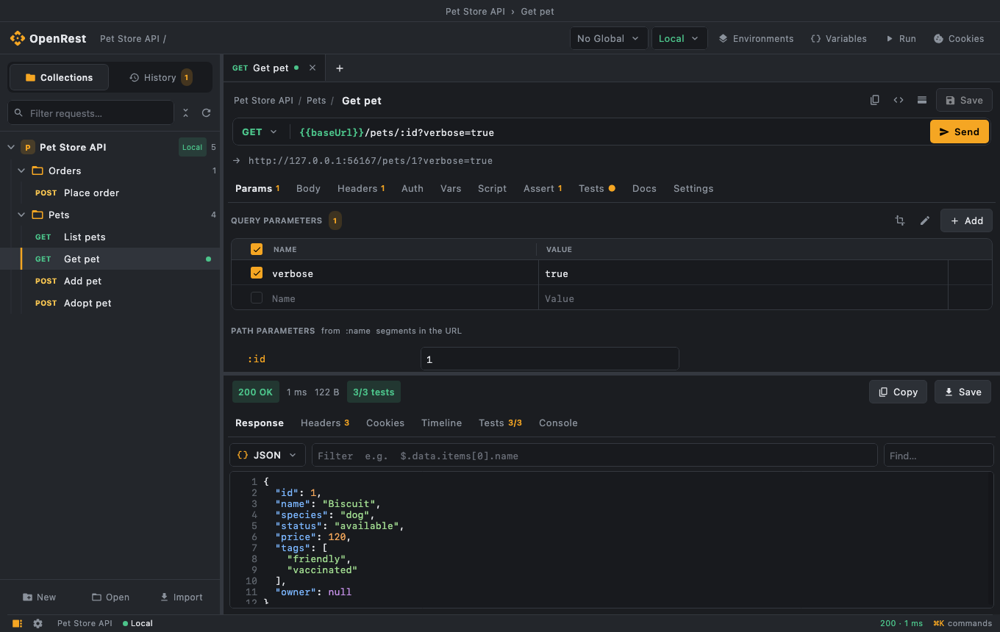
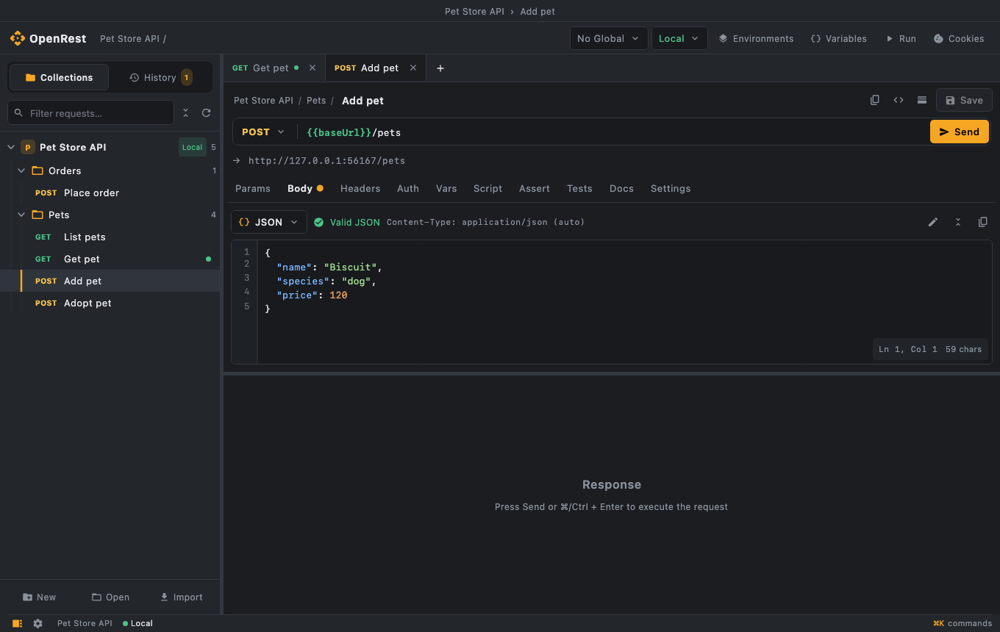
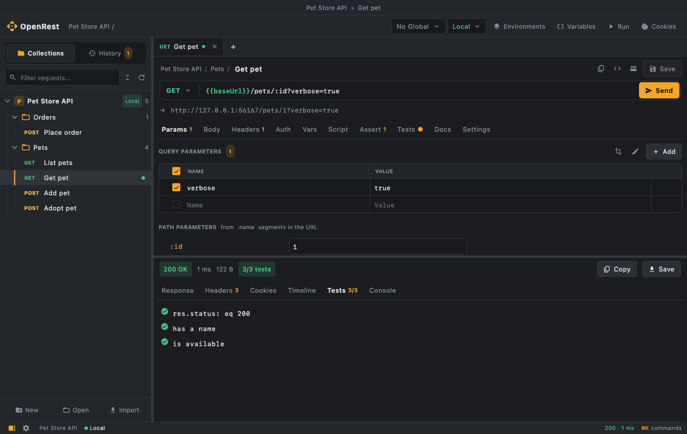
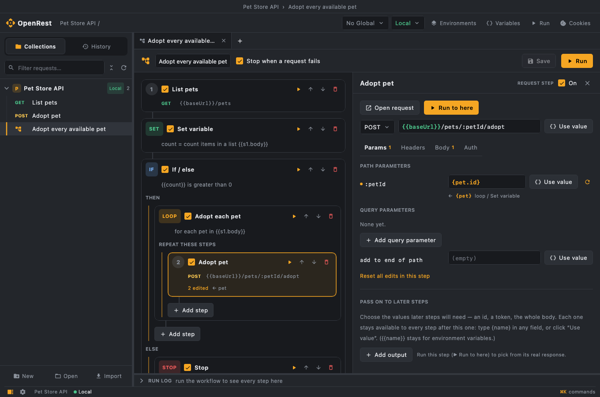
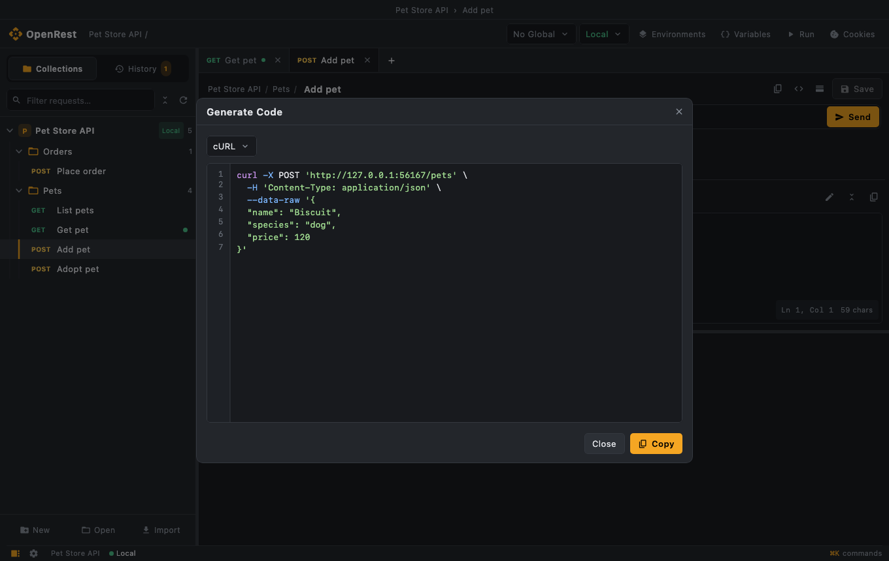
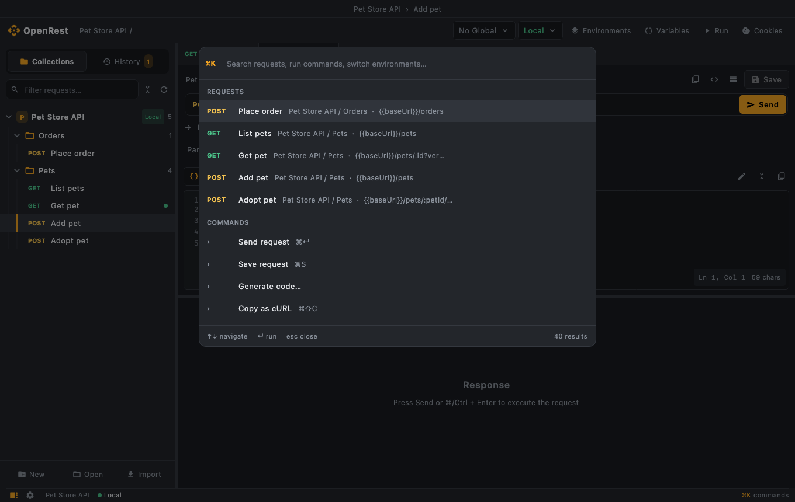
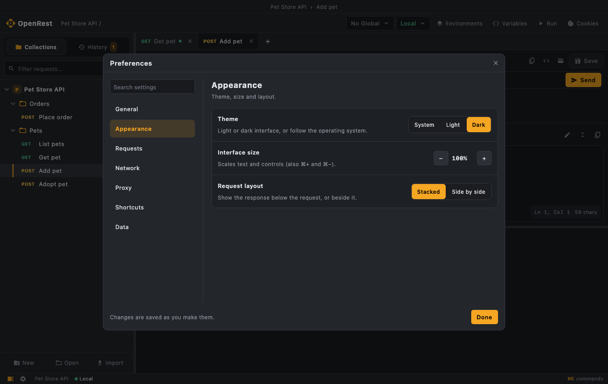

# Features

A tour of what OpenRest can do. For how-to steps see the [user manual](user-manual.md).

> Screenshots show a demo "Pet Store API" collection and predate GraphQL, WebSocket and the collection overview.

## Requests

- **HTTP**: GET, POST, PUT, PATCH, DELETE, HEAD, OPTIONS, TRACE. Query and `:path` parameters kept in sync with the URL; a resolved-URL line with undefined-variable warnings; paste a `curl` command to fill the request.
- **Bodies**: JSON (validated), XML, text, form URL encoded, multipart (text and files, several files at once) and binary file.
- **Auth**: None, Inherit, Basic, Bearer, API Key, Digest, OAuth 2.0 (client credentials and password grants, token cached).
- **Headers table** with autocomplete, inherited headers and the **auto-generated** ones OpenRest adds (auth, `Content-Type`, `Host`, `User-Agent`, cookies), each labelled with its source and hideable.
- **GraphQL**: query and variables editors, operation picker, prettify, a schema browser (introspection) that inserts fields, and a banner for errors inside a `200` response.
- **WebSocket**: connect with headers, auth and subprotocols; send saved messages; live, filterable log with JSON and hex views.
- **Per request**: timeout, URL encoding, client certificate, notes.

## Responses

Status, time and size; body as JSON, HTML, XML, raw, hex or base64; interactive JSON tree, HTML, image, PDF, audio and video preview; JSONPath filter; find; headers; cookies; timeline; tests; console; response history with diff; save to file.

## Collections

Folders of requests with shared headers, auth, variables, scripts, tests and TLS settings that nested folders and requests inherit. Each collection has an **overview** with counts, details, recent runs and Markdown **documentation**. Drag and drop to organise; filter by name.

## Environments and variables

Global and collection environments, secret variables kept out of your files, `{{variable}}` highlighting and autocomplete, dynamic values and `.env` support. See [environments and variables](environments-and-variables.md).

## Scripting and tests

JavaScript before and after requests, no-code assertions, post-response variables and `test()` / `expect()` tests. See [scripting and testing](scripting-and-testing.md).

## Workflows and runner

A visual builder with request, if/else, loop, set, wait and stop steps, values passed between steps and a run log ([workflows](workflows.md)). The **runner** runs a collection or folder with iterations, delays and stop-on-failure.

## Import, export and code generation

Import from Postman, Insomnia, OpenAPI, Bruno and cURL; export to OpenRest bundles, Postman, Bruno, OpenAPI, Insomnia, `.http` and shell scripts ([details](import-export.md)). Generate code in 17 clients.

## Network

Client certificates (PFX or PEM, per collection, folder or request), custom CA bundle, HTTP proxy, redirect control, SSL verification toggle and a session cookie jar.

## The app

Command palette, themes, interface zoom, stacked or side-by-side layout, tabs and layout restored on relaunch, update notice, one-click bug report, native menus on macOS and a custom title bar elsewhere.

