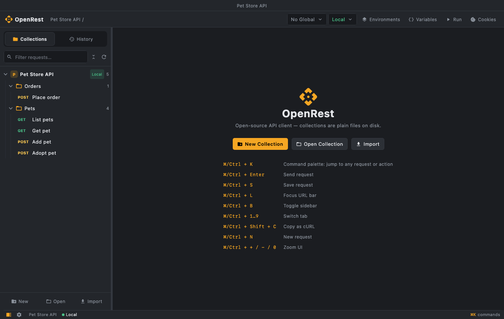

# Getting started

## Install

Download the installer for your system from the [latest release](../../../releases/latest).

| System | Files | How |
|---|---|---|
| macOS (Apple silicon and Intel) | `.dmg`, `.pkg` | Open the DMG and drag **OpenRest** to Applications |
| Windows | `.exe`, `.msix` | Run the setup program |
| Linux | `.deb`, `.rpm`, `.AppImage` | `sudo apt install ./<file>.deb`, `sudo dnf install ./<file>.rpm`, or make the AppImage executable and run it |

The installers are not code-signed yet. On macOS, right-click the app and choose **Open** the first time; Windows may show a SmartScreen warning.

To build from source instead, see [building and releasing](building-and-releasing.md).

## First run

A short walkthrough appears the first time: pick a theme, layout and text size, see the main shortcuts, then **create a collection**, **open a folder** or **import** one. Reopen it any time from **Help ▸ Welcome Tour**.

## Your first request

1. **New** in the sidebar (or ⌘N / Ctrl+N), name the collection and choose where it lives (default `~/OpenRest`).
2. Create a request (⌘N again). Choose **HTTP**, give it a name and a URL such as `https://httpbin.org/get`. You can paste a `curl` command in the URL box instead.
3. Press **Send** or ⌘↵ / Ctrl+Enter.
4. Read the response on the right or below: body, headers, cookies, timeline.
5. Press ⌘S / Ctrl+S to save. A file appears in the collection folder.

## Next steps

- Add `{{baseUrl}}` and friends with [environments](environments-and-variables.md).
- Add checks with [assertions and tests](scripting-and-testing.md).
- Chain requests with [workflows](workflows.md).
- Bring in existing work: [import](import-export.md).
- Learn the [shortcuts](keyboard-shortcuts.md), or open the command palette with ⌘K / Ctrl+K.
- The [user manual](user-manual.md) covers everything task by task.
