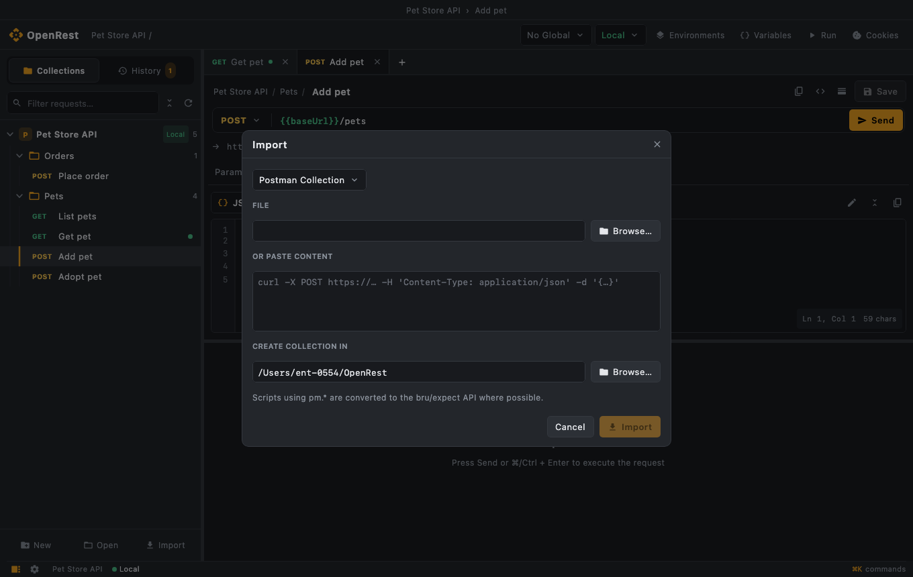
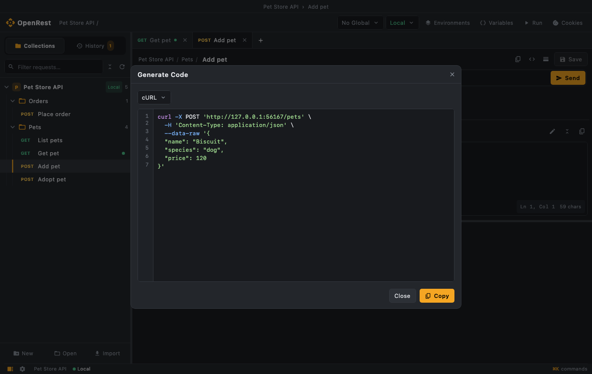

# Import and export

## Import

**File ▸ Import…**, the sidebar button or the command palette. Pick a type, choose a file (or paste content) and where to create the collection (default `~/OpenRest`).

| Type | Notes |
|---|---|
| Postman Collection | Folders, requests, bodies, auth, variables |
| Insomnia | Requests, folders, environments |
| OpenAPI / Swagger | JSON or YAML; requests grouped by tag; the server URL becomes `{{baseUrl}}` in a "Default" environment |
| Bruno Collection (folder) | Classic `.bru` layout and the newer YAML layout, detected automatically |
| OpenRest Bundle (YAML) | A single file exported by OpenRest |
| OpenRest Collection (folder) | Opens an existing folder with `openrest.yaml` |
| cURL | Adds one request to the open collection |
| Postman Environment | Into the open collection |
| Postman Environment (Global) | As a global environment |

You can also paste a `curl` command straight into a request's URL bar. HAR and `.http` files cannot be imported.

## Export

**File ▸ Export Collection…** (also the sidebar menu, palette and collection page).

| Format | File |
|---|---|
| OpenRest Bundle | `.openrest.yaml`, re-importable |
| Postman Collection v2.1 | `.postman_collection.json` |
| Bruno Collection | A folder of `.bru` files |
| OpenAPI 3.0 | `.openapi.yaml` or `.openapi.json` |
| Insomnia v4 | `.insomnia.json` |
| HTTP file | `.http`, for VS Code REST Client and JetBrains |
| Shell script | `.sh`, one curl command per request |

## Code generation

**Request ▸ Generate Code…** shows the request in: cURL, JavaScript (fetch, axios), Node.js, Python (requests), Java, Kotlin, Go, PHP, C#, Ruby, Swift, Rust, Dart, PowerShell, HTTPie and wget. Variables, inherited headers and auth are resolved; scripts are not run. **Copy as cURL** (⌘⇧C / Ctrl+Shift+C) copies the cURL form immediately.
