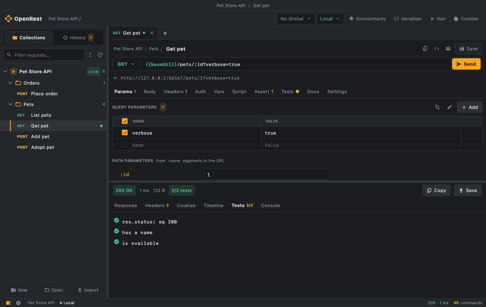

# Scripting and testing

Scripts are JavaScript. Use `await` freely; there is no `setTimeout`, use `await bru.sleep(ms)` (max 60 s per call). `fetch`, `process` and `Buffer` are not available, and `require` only provides `'chai'`.



## Where code goes

| Place | Purpose |
|---|---|
| **Vars ▸ Post Response** | Store an expression such as `res.body.id` into a variable |
| **Script ▸ Pre Request** | Change the request or set variables before sending |
| **Script ▸ Post Response** | Save values, log, choose the next request |
| **Assert** | No-code checks |
| **Tests** | `test()` / `expect()` |

Collections and folders have Scripts and Tests pages too. Order for one request:

1. Pre-request scripts: collection, folders (outermost first), request
2. Send
3. Post-response variables
4. Post-response scripts: request, folders (innermost first), collection
5. Assertions (the request's own only)
6. Tests: collection, folders, request

A script error becomes a failing row in the Tests tab.

## The API

**`req`** (pre-request only): `getUrl`, `setUrl`, `getMethod`, `setMethod`, `getName`, `getHeader`, `getHeaders`, `setHeader`, `setHeaders`, `deleteHeader`, `getBody`, `setBody`, `getTimeout`, `setTimeout`, `getAuthMode`.

**`res`** (after the response): `res('path')`, `status`, `statusText`, `headers` (lower-case keys), `body` (parsed JSON when possible), `responseTime`, `size`, `url`, plus `getStatus`, `getHeader`, `getHeaders`, `getBody`, `getResponseTime`, `getSize`, `getUrl`.

**`bru`**: `getVar`, `setVar`, `hasVar`, `deleteVar`, `deleteAllVars`, `getEnvVar`, `setEnvVar` (this session only), `getEnvName`, `getCollectionName`, `getCollectionVar`, `getFolderVar`, `getRequestVar`, `getProcessEnv`, `interpolate`, `sleep`, `setNextRequest`, `runner.skipRequest`, `runner.stopExecution`, `runner.setNextRequest`.

**`console`**: `log`, `info`, `warn`, `error`, `debug`. Output appears in the response's **Console** tab.

**Globals**: `test`, `it`, `describe`, `expect`, `btoa`, `atob`.

```js
// Post Response
bru.setVar('token', res.body.token);
console.log('logged in as', res.body.user);
```

## Tests

```js
test('created', () => {
  expect(res.status).to.equal(201);
  expect(res.body).to.have.property('id');
});
```

`expect` is a Chai subset: `equal`, `eql`, `above`, `least`, `below`, `most`, `within`, `property`, `include`, `keys`, `lengthOf`, `match`, `string`, `oneOf`, `satisfy`, `instanceof`, `members`, `closeTo`, `a`/`an`, `throw`, with `not`, `deep` and flags such as `ok`, `true`, `null`, `exist`, `empty`. The Tests tab has snippets to start from.

## Assertions

The first box is an expression using `res` (for example `res.status`, `res.body.name`, `res.headers['content-type']`); the second is an operator and value, which may contain `{{variables}}`.

`eq`, `neq`, `gt`, `gte`, `lt`, `lte`, `in`, `notIn`, `contains`, `notContains`, `length`, `matches`, `notMatches`, `startsWith`, `endsWith`, `between` (`a, b`), `isEmpty`, `isNotEmpty`, `isNull`, `isUndefined`, `isDefined`, `isTruthy`, `isFalsy`, `isJson`, `isNumber`, `isString`, `isBoolean`, `isArray`.

## Controlling a run

In the runner: `bru.setNextRequest('Name')` jumps to that request (or ends the run if it is not found); `bru.runner.skipRequest()` skips the current one; `bru.runner.stopExecution()` ends the run.

## The runner


Open it with **Request ▸ Run Collection…**, a folder's **Run Folder**, or the collection's **Run** button. Tick and reorder requests, set **Iterations** (1–100), **Delay (ms)** and **Stop on failure**. Results show passed, failed and skipped counts, filters, **Re-run failed**, **Copy summary** and **Export results…** (JSON). WebSocket requests are skipped.
