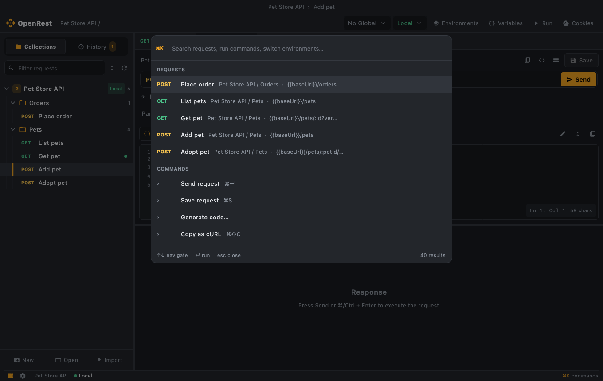
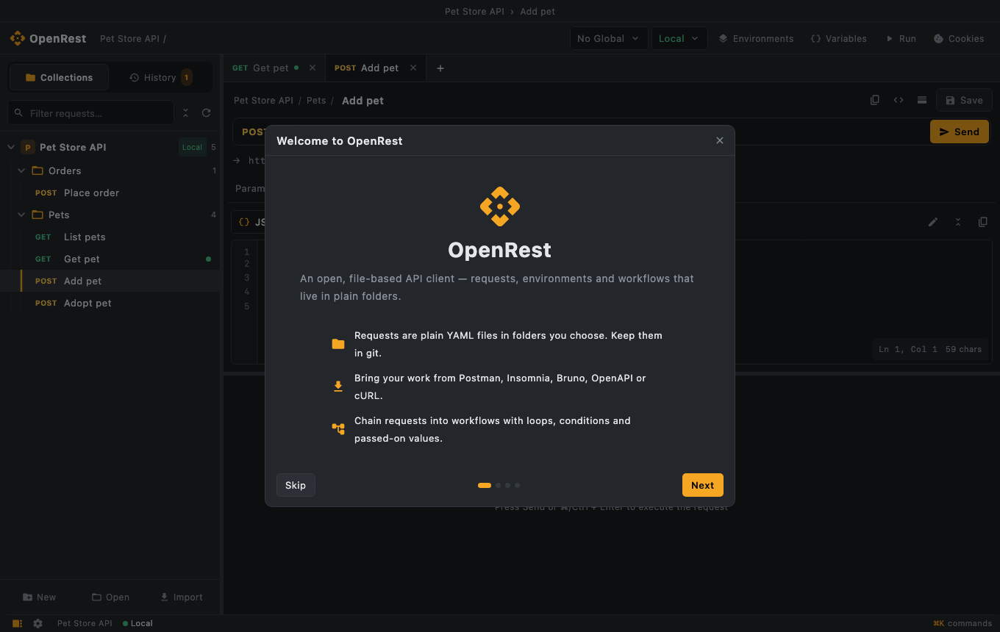
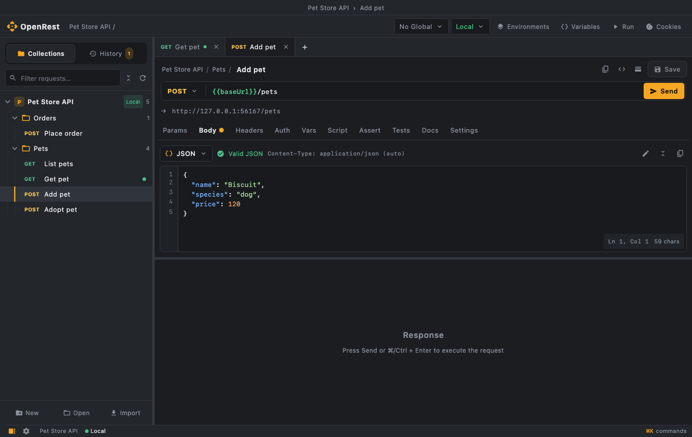
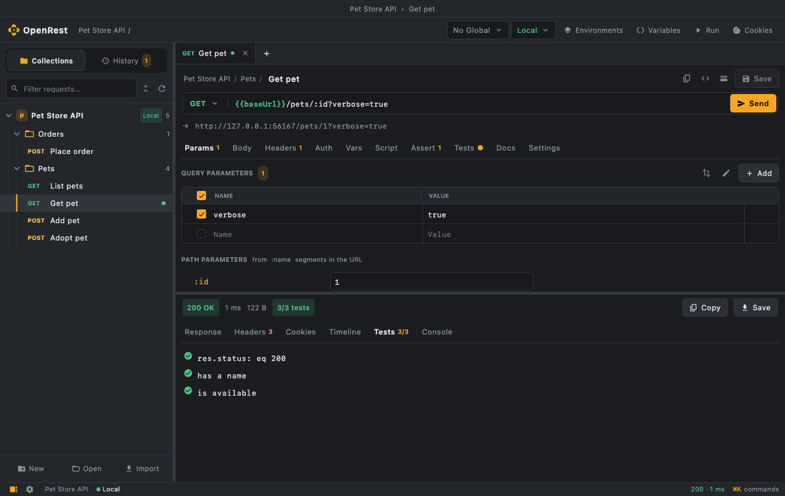
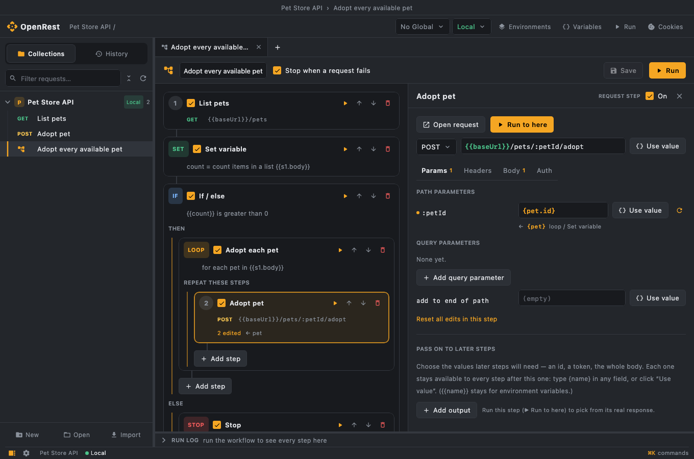
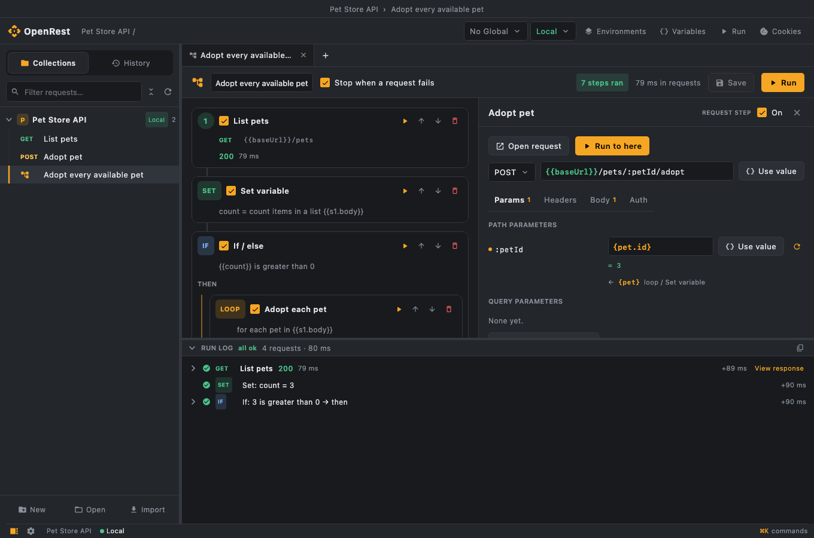
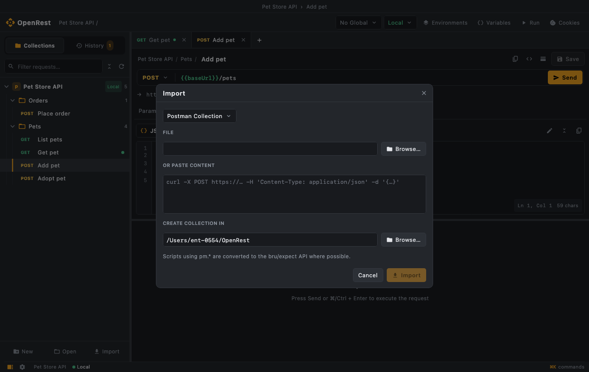
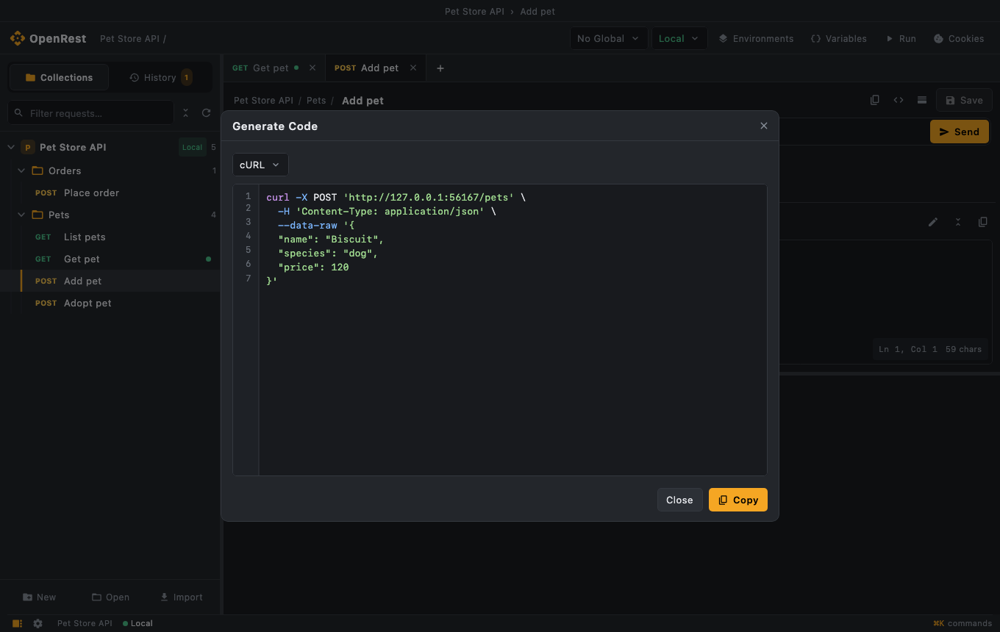
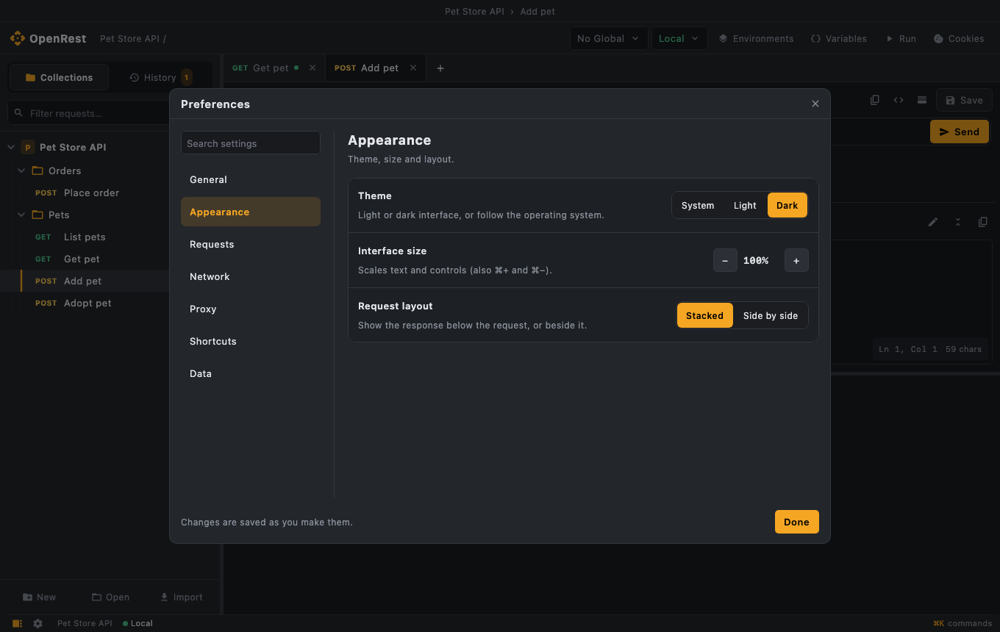
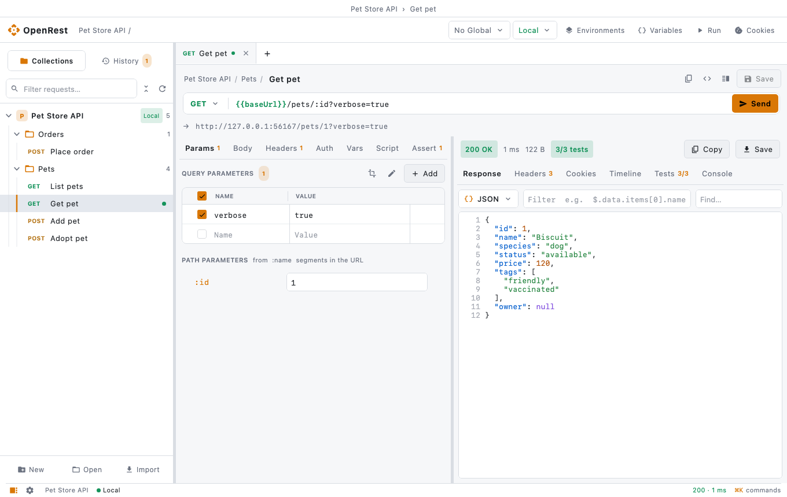

# OpenRest user manual

This manual walks through everyday tasks in OpenRest, in the order you will meet them. For a quick overview see the [README](../README.md); for reference pages on one topic follow the links.

> The screenshots show a demo "Pet Store API" collection. Some were taken before GraphQL, WebSocket and the collection overview were added, so a few details (accent colours, extra tabs) look slightly different in the current app.

**Contents**

1. [The window](#1-the-window)
2. [Collections](#2-collections)
3. [HTTP requests](#3-http-requests)
4. [Reading a response](#4-reading-a-response)
5. [GraphQL requests](#5-graphql-requests)
6. [WebSocket requests](#6-websocket-requests)
7. [Environments and variables](#7-environments-and-variables)
8. [Scripts, assertions and tests](#8-scripts-assertions-and-tests)
9. [Workflows](#9-workflows)
10. [Running a whole collection](#10-running-a-whole-collection)
11. [Import, export and code generation](#11-import-export-and-code-generation)
12. [Certificates, proxy and cookies](#12-certificates-proxy-and-cookies)
13. [Preferences](#13-preferences)
14. [Updates and reporting problems](#14-updates-and-reporting-problems)
15. [Where your files are](#15-where-your-files-are)

---

## 1. The window

- **Title bar.** Shows the collection and the open item. On macOS the window buttons and menu bar are the system's; on Windows and Linux OpenRest draws its own buttons and puts the menus in the bar. Drag the bar to move the window and double-click it to maximise or restore (zoom on macOS). Right-click it for the system window menu on Windows and Linux.
- **Sidebar.** Two tabs: **Collections** (your folders, requests and workflows) and **History** (what you sent in this session). Below the list are **New**, **Open** and **Import**. Hide or show it with ⌘B / Ctrl+B.
- **Tabs.** Every request, workflow, runner and collection opens in a tab. Unsaved tabs show a dot. Drag a tab to reorder, middle-click to close, right-click for Send, Save, Copy as cURL, Generate Code, Close and more. The **+** at the end makes a new request.
- **Editor and response.** The request is above the response (**Stacked**) or beside it (**Side by side**; switch with ⌘⇧L / Ctrl+Shift+L). Drag the divider to resize.
- **Status bar.** From the left: sidebar toggle, **Preferences**, a **download icon** when an update exists, the **GitHub / Developer** button and the **bug icon** to report a problem; then the collection name, the active environment, the global environment, how many runtime variables are set, and the result of the last request. **⌘K commands** on the right opens the palette.

### The command palette

Press ⌘K / Ctrl+K (or ⌘P). Type to find any request in any open collection, or a command: send, save, new request / GraphQL / WebSocket / folder / workflow, run a collection, switch environment, change theme, zoom, import, preferences and more. ↑ ↓ to move, ↵ to run, Esc to close.

### First run

The first time you open OpenRest a short walkthrough appears (welcome, theme and layout, a quick tour of shortcuts, and cards to create, open or import a collection). Bring it back with **Help ▸ Welcome Tour**.

---

## 2. Collections

A **collection** is a folder on your computer. Requests are files inside it, so you can keep it in git. See [file format](file-format.md).

### Create, open and close

- **New collection:** **New** in the sidebar, **File ▸ New Collection…**, or ⌘N when nothing is open. Choose a name and where to create it (default `~/OpenRest`).
- **Open an existing one:** **Open** in the sidebar or **File ▸ Open Collection…**, and pick a folder that contains `openrest.yaml`.
- **Close:** right-click the collection ▸ **Close Collection**. Your files are not touched.
- **Reload from disk:** if you edit files elsewhere, OpenRest reloads when you return to the window. The reload button above the list forces it.

### Add requests, folders and workflows

Right-click a collection or folder (or use **File ▸ New Request / New Folder / New Workflow**, or the **+** on a row). When you create a request you choose its type with the cards at the top: **HTTP**, **GraphQL** or **WebSocket** (gRPC is shown as "soon"). Paste a `curl …` command into the URL box instead of a name to create a request from it.

### Organise

- **Drag and drop** requests and folders: drop on a folder to move into it, between requests to reorder.
- Right-click a request for **Open, Rename, Clone, Move Up / Down, Reveal in Finder / Explorer, Delete**; a folder for **Run Folder, Settings, Rename, Clone, Reveal, Delete**; a workflow for **Open, Run, Rename, Clone, Delete**.
- Keyboard: ↑ ↓ move, → opens a folder, ← closes it or goes to its parent, ↵ opens, **F2** renames, **Delete** deletes.
- The filter box finds requests by name; the two small buttons beside it collapse or expand every folder.

### The collection page

Click a collection's name in the title bar, or choose **Overview / Settings** from its menu, to open its tab.

- **Overview** shows counts of requests, folders, workflows and environments, a **Details** card (location, active environments, last modified, requests by method, recent runs) and a **Documentation** card. Click the pencil to write Markdown notes for the collection; **Preview** switches between the editor and the rendered text, **Save** stores it (in `openrest.yaml`) and **Close** leaves editing. The header has **Run**, **New request**, **Environments** and **Export…**.
- **Headers, Auth, Variables, Scripts, Tests, TLS** are settings shared by every request in the collection. A request can override them, and so can a folder (right-click ▸ **Settings**). The order of application is collection, then folder, then request. Each page's tab shows a count or dot when it has something in it. **Save** and **Revert** are at the bottom.

---

## 3. HTTP requests

### Sending

Pick a method, type the URL (a bare host such as `example.com/api` gets `http://`), and press **Send** or ⌘↵ / Ctrl+Enter. **Cancel** stops a request in flight. ⌘S / Ctrl+S saves; **Save automatically** in Preferences saves before sending.

- **Paste a curl command** into the URL box and OpenRest fills in the method, headers, body, auth and certificates.
- **Path parameters:** write `:id` in the URL and a **Path Parameters** section appears. **Query parameters** and the URL stay in sync both ways.
- **Resolved URL:** when the URL contains `{{variables}}` or `:params`, the line under the URL bar shows what will really be called. A red `undefined: …` chip lists variables that have no value.

### The tabs

| Tab | What it is |
|---|---|
| **Params** | Query parameters, and path parameters from `:name` in the URL |
| **Body** | None, JSON, XML, Text, GraphQL, Form URL Encoded, Multipart Form or Binary File |
| **Headers** | Your headers, plus the inherited and auto-generated ones (below) |
| **Auth** | None, Inherit, Basic, Bearer, API Key, Digest, OAuth 2.0 |
| **Vars** | Pre-request variables and post-response variables (values taken from the response) |
| **Script** | JavaScript before and after the request, with a **Snippets** bar |
| **Assert** | No-code checks on the response |
| **Tests** | `test()` / `expect()` tests |
| **Docs** | Notes about this request |
| **Settings** | URL encoding, timeout, and a client certificate for this request |

Counts and dots on the tab names show what is set.

### Bodies

- **JSON** is validated as you type, with the error line marked (`{{variables}}` are allowed). **Form URL Encoded** and **Multipart Form** are tables. **Binary File** sends one file as the body.
- In **Multipart**, each row is text or a file (toggle the paperclip). Click the **folder** icon to choose files: pick several at once and the first fills the row while each extra file becomes its own row below it with the same field name. A file row shows only the file name; hover for the full path, click the name to edit the path (it can contain `{{variables}}`).

### Headers

The Headers tab shows three things:

1. **Request Headers**: the table you edit. Names and values autocomplete.
2. **Inherited Headers** (read-only): from the collection and folders above the request.
3. **Auto-generated** rows at the bottom of the same table, marked with a lock and a small label saying where each comes from: `Auth` (the `Authorization` header or API key from the Auth tab), `Body` (`Content-Type`, `Content-Length`), `Client` (`Host`, `User-Agent`, `Accept`, `Accept-Encoding`) and `Cookie jar`. Values that only exist at send time, such as an OAuth token or a multipart boundary, say so. Add a header with the same name above and the generated one disappears. The **eye** button beside the header count hides or shows them, and remembers your choice.

### Auth

Choose **Inherit** (the default for requests) to use the folder's or collection's auth. **OAuth 2.0** supports client-credentials and password grants and caches the token until it expires. **Digest** retries once after the server's challenge. Fields can use `{{variables}}`, and you should keep real tokens in a secret [environment variable](#7-environments-and-variables).

---

## 4. Reading a response

The bar above the response shows the **status**, **time**, **size** and test results (click `3/3 tests` to jump to them). **Copy** and **Save** act on the body.

| Tab | Shows |
|---|---|
| **Response** | The body. Choose **JSON / HTML / XML / Raw / Hex / Base64** from the menu; turn **Preview** on for an interactive JSON tree, a rendered page, or an image, PDF, audio or video |
| **Headers** | Response headers, sorted, with copy |
| **Cookies** | Cookies the response set |
| **Timeline** | The request as sent, the status and time, and the final URL after redirects |
| **Tests** | Every assertion and test, passed or failed |
| **Console** | Output of `console.log` in your scripts |

- **Filter** a JSON body with a path such as `$.data.items[0].name` (dot keys, `[n]` indexes and `.length`).
- **Find** searches the text; ↵ jumps to the next match.
- Every send is kept as a **response history** for that request; pick an older one from the dropdown, and **Diff** compares it with the previous response.
- If a request fails you get an **ERROR** page with the reason and, for common problems, a hint.
- The sidebar's **History** tab lists everything you sent in this session (up to 200); click one to reopen it with its response. History is not saved when you quit.

---

## 5. GraphQL requests

Create one with the **GraphQL** card in the new-request dialog (or the palette: **New GraphQL request**). It opens on the **Body** tab, which has a **Query** editor and a **Variables (JSON)** editor.

- **Operation.** When your document has several named operations, an **Operation** menu appears. Choose which one to run; **Auto** sends none and lets the server decide.
- **Prettify** re-indents the query (and, next to Variables, the JSON).
- **Docs.** Click **Docs** (top right of the body) to open a floating schema browser. Press **Fetch schema** (it uses this request's URL, auth and headers) and you get Query / Mutation / Subscription entries, a **Find a type** box, and the arguments and types of every field. Click a field to insert it into the query (required arguments become `$variables`); click the **›** arrow to open its type; **‹** goes back. The reload icon fetches the schema again. If the server has introspection turned off you will see why.
- **Errors.** GraphQL servers usually answer `200` even when something failed. When the response contains an `errors` list, a red banner above the body shows each message with its line and path.

The request is an ordinary `POST` with a JSON body, so headers, auth, variables, scripts, assertions and the generated-headers table all work the same.

---

## 6. WebSocket requests

Create one with the **WebSocket** card. The URL bar shows a **WS** label and a **Connect** button; `ws://` and `wss://` addresses work (an `http(s)://` address is converted).

- **Connect** uses the request's headers, auth, cookies, variables and certificate like an HTTP request. The **Params**, **Headers** and **Auth** tabs work as usual; **Protocols** takes a comma-separated list of subprotocols (for example `graphql-transport-ws`) and the server's choice is shown when connected. Press **Cancel** while connecting, **Disconnect** when open.
- **Message** (the first tab) is where you write what to send. `{{variables}}` are filled in when you press **Send**. **Save message** keeps it as a chip under the editor; click a chip to reuse it, its **×** to delete it.
- **The log** (the response side) lists connection events, messages you sent (**↑**) and received (**↓**) with time and size. Click a row to expand it: JSON is pretty-printed and binary messages show a hex dump, each with a copy button. **All / Sent / Received** filters the list and **Clear** empties it. It keeps the latest 2,000 entries and follows new messages unless you scroll up.
- Press ⌘↵ / Ctrl+Enter to connect, or to send the message once connected. Closing the tab disconnects. WebSocket requests are skipped by the collection runner.

---

## 7. Environments and variables

An **environment** is a named set of variables such as `baseUrl` and `token`. Write `{{name}}` anywhere (URL, headers, body, auth, scripts); defined variables are green and missing ones red, and typing `{{` autocompletes.

- **Collection environments** live in the collection; **global environments** are shared by all collections. Choose the active ones from **Request ▸ Environment** and **Request ▸ Global Environment**, the status bar, or the palette. Manage them with **Environments** (header or collection page).
- Mark a variable **secret** and its value is kept out of your files, in `~/.openrest/secrets.json`.
- **Variables…** (View menu) shows everything in scope and where each value comes from, and can clear runtime variables.
- If the same name is set in several places, the closest wins: runtime (set by scripts), then request, folder, collection environment, collection variables and global environment.
- Built-ins: `{{$guid}}`, `{{$timestamp}}`, `{{$isoTimestamp}}`, `{{$randomInt}}` and more, and `{{process.env.NAME}}` (from a `.env` file in the collection or your system).

Full details: [Environments and variables](environments-and-variables.md).

---

## 8. Scripts, assertions and tests

- **Assert** tab: pick an expression such as `res.status` and a check such as `eq 200`.
- **Script** tab: JavaScript before the request (change the URL, headers or body, set variables) and after the response (save a token, log, choose the next request). `await` works.
- **Tests** tab: `test('name', () => expect(res.status).to.equal(200))`.
- **Vars ▸ Post Response**: store `res.body.id` into `{{id}}` with no code.

Results appear in the response's **Tests** tab and as `3/3 tests` in the status bar. Full reference: [Scripting and testing](scripting-and-testing.md).

---

## 9. Workflows

A **workflow** chains requests with logic, passing values from one step to the next. Create it with **File ▸ New Workflow**. Add **Request**, **If / else**, **Loop**, **Set variable**, **Wait** and **Stop** steps; give a value from a response a name with **Add output** and every later step can use it as `{name}`. **Run** executes it, **Run to here** (▶ on a step) stops at that step, and the docked **Run log** shows what happened.

Full guide: [Workflows](workflows.md).

---

## 10. Running a whole collection

**Run** (header), **Request ▸ Run Collection…**, or a folder's **Run Folder** opens the runner. Tick the requests to include and drag to reorder, then set **Iterations**, a **Delay (ms)** between requests and **Stop on failure**. The results show passed, failed and skipped counts, response times and tests; filter them, expand an iteration, **Re-run failed**, **Copy summary** or **Export results…** to a JSON file.

---

## 11. Import, export and code generation

- **Import** (**File ▸ Import…**, sidebar, or palette): Postman collections and environments, Insomnia, OpenAPI / Swagger, Bruno (both layouts), a cURL command, and OpenRest bundles or folders.
- **Export** (**File ▸ Export Collection…**): OpenRest bundle, Postman v2.1, Bruno, OpenAPI (YAML or JSON), Insomnia v4, a `.http` file and a shell script of cURL commands.
- **Generate Code** (Request menu or a tab's right-click): cURL, JavaScript (fetch, axios), Node.js, Python, Java, Kotlin, Go, PHP, C#, Ruby, Swift, Rust, Dart, PowerShell, HTTPie and wget. **Copy as cURL** (⌘⇧C) copies the cURL form straight away.

See [Import and export](import-export.md).

---

## 12. Certificates, proxy and cookies

- **Client certificates (mutual TLS).** Open **Settings** on a request, or the **TLS** page of a collection or folder, and choose **PFX / PKCS#12** or **PEM** (certificate plus private key). Optionally add a **CA bundle** to trust a private CA, and a passphrase (best kept in a secret variable like `{{certPassphrase}}`). Only the file paths are stored. Relative paths are resolved from the collection folder, so they can travel with the collection; absolute paths will not work on another machine. A request's setting beats its folder's, which beats the collection's.
- **Proxy.** **Preferences ▸ Proxy**: turn it on and enter host and port.
- **SSL verification.** On by default. Turn it off in **Preferences ▸ Network** only for local servers with self-signed certificates.
- **Cookies.** Cookies from responses are kept for the session and sent back to the sites that set them (also on WebSocket connections). **View ▸ Cookies…** (or Preferences ▸ Network ▸ Manage…) lists them by domain, lets you remove some or **Clear all**. They are gone when you quit.

---

## 13. Preferences

**Preferences** (⌘, / Ctrl+, or the gear in the status bar) saves as you change things. Use the search box to find a setting.

| Section | Settings |
|---|---|
| **General** | Save automatically |
| **Appearance** | Theme (System, Light, Dark), Interface size (also ⌘+ / ⌘−), Request layout (Stacked or Side by side) |
| **Requests** | Timeout (ms, 0 = none), Follow redirects, Maximum redirects, User-Agent (empty = `OpenRest/<version>`) |
| **Network** | Verify SSL certificates, Cookies (Manage…, Clear all) |
| **Proxy** | Use an HTTP proxy, host, port |
| **Shortcuts** | The main keyboard shortcuts (the full list is in [keyboard shortcuts](keyboard-shortcuts.md)) |
| **Data** | Where your files are (reveal button) and **Reset preferences** |

---

## 14. Updates and reporting problems

- **Updates.** When OpenRest starts it asks GitHub whether a newer release exists. If it does, a **download icon** appears in the status bar and a dialog offers **Download** (opens the releases page) or **Later**. Later hides the dialog for that version but keeps the icon. **Help ▸ Check for Updates…** checks on demand and tells you if it could not reach GitHub.
- **Report a problem.** Click the **bug icon** in the status bar. Your browser opens a new GitHub issue with a short template and your OpenRest version and operating system filled in. Nothing else is added, and nothing is sent until you submit it on GitHub.
- **Developer.** The GitHub button opens the developer dialog with links to the project and more apps.

---

## 15. Where your files are

| What | Where |
|---|---|
| Requests, folders, environments, workflows, collection notes | The collection folder you chose |
| Settings | `~/.openrest/settings.json` |
| Open collections, open tabs, layout | `~/.openrest/state.json` |
| Small flags (such as the update you dismissed) | `~/.openrest/prefs.json` |
| Window size and position | `~/.openrest/window.json` |
| Secret variable values | `~/.openrest/secrets.json` |
| Global environments | `~/.openrest/environments/` |
| Log | `~/.openrest/openrest.log` |

**Help ▸ Show Data Folder** opens it. On Windows the folder is `%USERPROFILE%\.openrest`. To start fresh, quit OpenRest and move that folder; your collections are not inside it. More in [Troubleshooting](troubleshooting.md).
