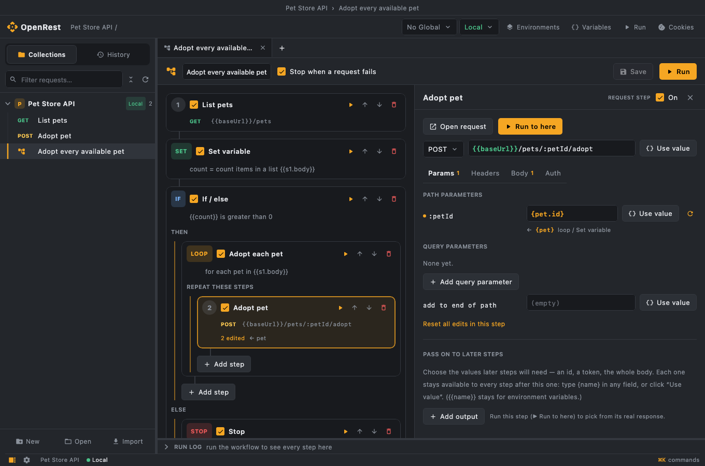

# Workflows

A **workflow** chains requests with logic so the output of one call feeds the next: log in then call a protected endpoint, list items then update each, poll until ready, or run a whole scenario as one repeatable flow.

Create one with **File ▸ New Workflow**, a collection's menu, or the command palette. Workflows are saved in the collection's `workflows/` folder.



## Steps

| Step | What it does |
|---|---|
| **Request** | Calls a request from the collection |
| **If / else** | Runs different steps depending on conditions |
| **Loop** | Repeats steps for each item in a list, N times, or while a condition is true |
| **Set variable** | Stores a value, or counts, adds up or picks items from a list |
| **Wait** | Pauses for a number of milliseconds |
| **Stop** | Ends the loop or the whole workflow, optionally marking it failed |

Add steps with **Add Step…**. Every step has an on/off switch and an optional title; ▶ on a step runs the workflow up to that step.

## Passing values

On a **Request** step:

- **Inputs** set part of the request before it runs: a path parameter, query parameter, header, JSON body field, the whole body, the bearer token, the whole URL, the method, text appended to the URL path, or a variable.
- **Outputs** name a value from the response: the whole response, the body (or a field of it, by path), the status code, a header, or the response time.

Later steps use outputs as `{name}` or `{name.field}`, or by step id: `{{s1.body.data.id}}`, `{{s2.header.X-Id}}`, `{{s1.status}}`. Outputs also become ordinary `{{name}}` variables, and `{{user.id}}` works when the value is JSON.

## Conditions

A condition compares two values: equals, does not equal, contains, does not contain, starts with, is greater than, is at least, is less than, is at most, is empty, is not empty, matches pattern. Choose whether **all** or **any** must be true. With no conditions the result is never true.

## Loops

- **For each item in a list**: the item is available as `item` and its position as `index` (starting at 0); you can rename both.
- **Repeat a number of times**.
- **Repeat while a condition is true**.

Every loop stops after at most 100 rounds by default (changeable).

## Set variable

Set to a value, count items in a list, add up numbers in a list (optionally a field of each item), or take the first or last item.

## Failure handling

By default a failed request stops the workflow (**Stop when a request fails**). Switch that off for the whole workflow, or mark one step **continue on fail**. A deleted request is reported as an error on its step. Scripts can end a run with `bru.runner.stopExecution()`.

## Running and the run log

**Run** executes the workflow; **Stop** cancels. The docked **Run log** (Workflow ▸ Show Run Log) shows each step with its timing, the values it passes on, warnings, and links to **View full response** and **Configure this step**. **Only problems** filters it, and the copy icon copies the log.


## File

```yaml
name: Checkout
stopOnFail: false
steps:
  - id: s1
    request: Auth/Login
    outputs:
      - {name: token, from: body, path: token}
  - id: s2
    request: Orders/List
    inputs:
      - {target: bearer, value: '{token}'}
```
